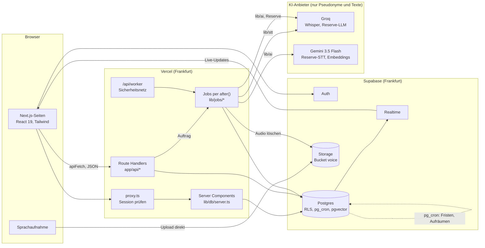
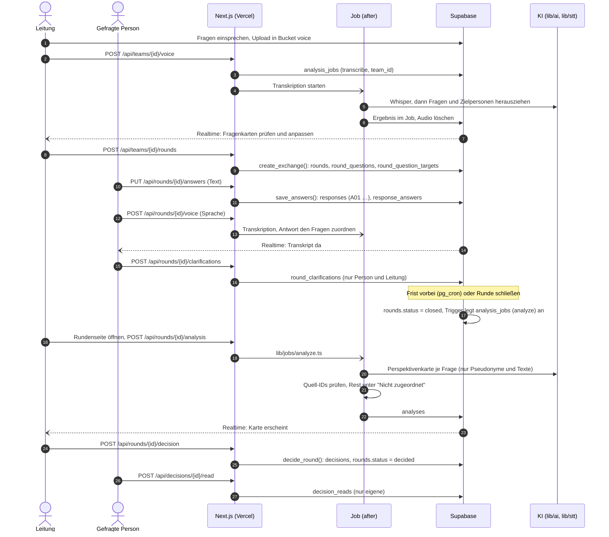
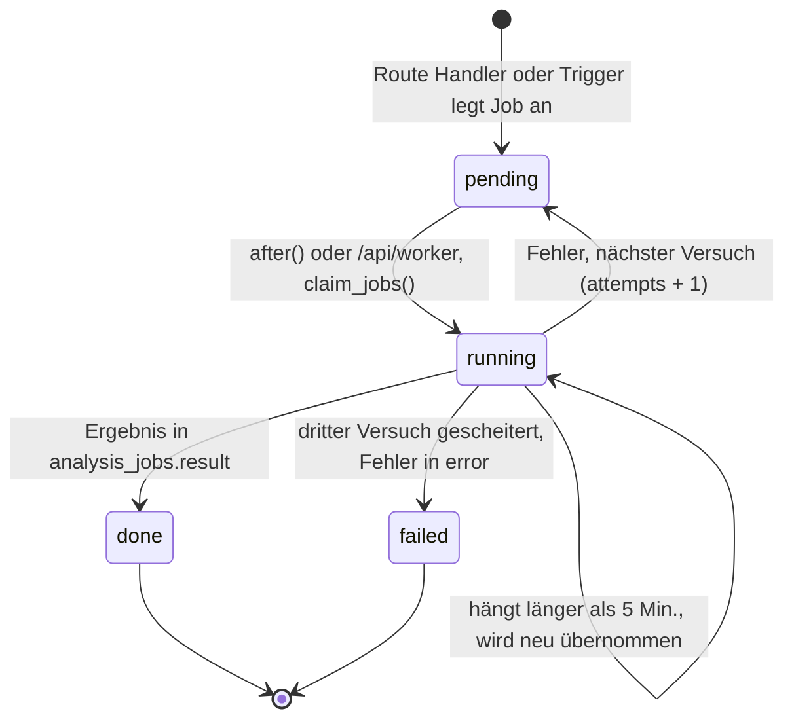
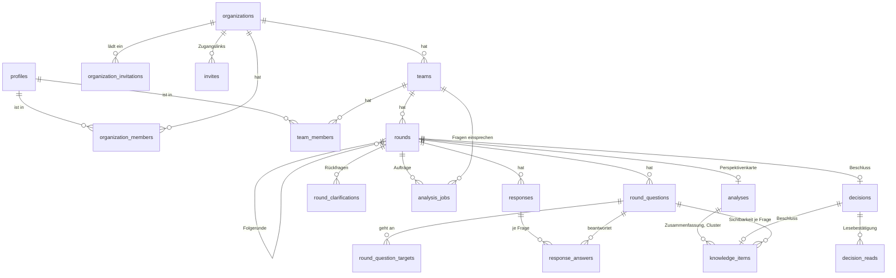

# Architektur

Wie CoFuture aufgebaut ist und wie die Teile zusammenspielen. Die Diagramme sind Mermaid und werden auf GitHub als Schaubild angezeigt.

**Pflege:** Wer die Architektur ändert (neue Tabelle, neuer Dienst, neuer Job-Typ, neuer KI-Schritt, neuer Ablauf), passt die betroffenen Diagramme im selben PR an und ergänzt das [Änderungsprotokoll](#änderungsprotokoll). Die CI prüft, dass jede Tabelle aus `supabase/migrations/` im [Datenmodell](#datenmodell) vorkommt (`pnpm docs:check`).

**Inhalt:** [Systemüberblick](#systemüberblick) · [Ablauf eines Austauschs](#ablauf-eines-austauschs) · [Hintergrundjobs](#hintergrundjobs) · [Datenmodell](#datenmodell) · [Regeln im Code](#regeln-im-code) · [Repo-Struktur](#repo-struktur) · [Änderungsprotokoll](#änderungsprotokoll)

Verwandt: [Tech-Stack](tech-stack.md) · [API](api.md) · [ADRs](adr/README.md)

## Systemüberblick



## Ablauf eines Austauschs

Kernfeature AsyncMeet nach [ADR 012](adr/012-austausch-mehrere-fragen.md). Endpunkte im Detail in [`api.md`](api.md).



## Hintergrundjobs

Transkription und Analyse laufen nie im Request. `claim_jobs()` sorgt dafür, dass jeder Auftrag nur einmal läuft.



| Job-Typ | Code | Was passiert |
| --- | --- | --- |
| `transcribe` | `lib/jobs/transcribe.ts`, danach `lib/jobs/structure.ts` | Audio → Text (`lib/stt`), dann Fragen herausziehen (Team-Job) oder Antwort den Fragen zuordnen (`lib/ai/exchange.ts`), Audio löschen |
| `analyze` | `lib/jobs/analyze.ts` | Perspektivenkarte je Frage (`lib/ai/perspective-map.ts`), Quellenprüfung mit `finalizeMap()` |
| Embeddings (kein Eintrag in `analysis_jobs`) | `lib/jobs/embed.ts` | Trigger legen Einträge in `knowledge_items` an, der Job holt über `claim_knowledge_items()` alle ohne Vektor und berechnet sie (`lib/ai/embed.ts`). Start nach Analyse und Beschluss, Sicherheitsnetz `/api/worker` |

**Zeitlimits je Anbieter:** Transkription 90 s, Fragen und Antworten zuordnen 15 s, Perspektivenkarte 45 s. Danach übernimmt die Reserve. Ein überlasteter Anbieter (429, 5xx, keine Antwort) wird zwei Minuten übersprungen.

## Datenmodell

Vereinfacht, nur Tabellen und Beziehungen. Jede Tabelle hat Row Level Security. Quelle: `supabase/migrations/`, Typen in `lib/db/types.ts`.



| Tabelle | Zweck |
| --- | --- |
| `profiles` | Konto mit Anzeigename, angelegt per Trigger aus Supabase Auth |
| `organizations`, `organization_members` | Mandanten und Mitgliedschaft mit Rolle Owner, Mitglied oder Gast |
| `organization_invitations` | Einladungen an bestehende Konten, mit Annehmen und Ablehnen |
| `invites` | einmalige Zugangslinks, nur der Hash wird gespeichert |
| `teams`, `team_members` | Teams einer Organisation und ihre Mitglieder |
| `rounds` | ein Austausch mit optionaler Frist und Status, `parent_round_id` für Folgerunden |
| `round_questions`, `round_question_targets` | Fragen eines Austauschs und an wen sie gehen |
| `responses`, `response_answers` | eine Antwort je Person (Pseudonym A01 …) und ihre Teile je Frage |
| `round_clarifications` | Rückfragen an die Leitung, sichtbar nur für Beteiligte |
| `analysis_jobs` | Hintergrundaufträge `transcribe` und `analyze` mit Status, Versuchen, Ergebnis und Fehler |
| `analyses` | Perspektivenkarte je Runde mit `prompt_version` |
| `decisions`, `decision_reads` | Beschluss mit Begründung und Lesebestätigungen ohne Namen |
| `knowledge_items` | Wissensspeicher: Zusammenfassungen, Cluster und Beschlüsse mit Volltext-Index und Vektor, Sichtbarkeit wie das Original ([ADR 013](adr/013-wissensspeicher.md)) |

## Regeln im Code

- **Rechte liegen in der Datenbank.** Jede Tabelle hat Row Level Security. Server-Code mit Admin-Rechten (`lib/db/admin.ts`) nur in Jobs, Worker und Zugangslinks.
- **Schwere Arbeit läuft als Job.** Transkription und Analyse laufen nie im Request, sondern über `analysis_jobs`.
- **KI nur über Adapter.** Anbieter und Modelle nur in `lib/ai/llm.ts` und `lib/stt/index.ts`. Prompts versioniert in `prompts/v1/`, nie überschreiben.
- **Mensch entscheidet.** Beschlüsse schreibt immer eine Person. „Entschieden“ gibt es nur zusammen mit einem Beschluss, Beschlüsse sind danach unveränderlich. Lesebestätigungen zählen nur, ohne Namen.
- **Belegbar.** Jede Aussage der Karte braucht eine gültige Quell-ID. Was das Modell nicht einordnet, landet sichtbar unter „Nicht zugeordnet“. Abdeckung immer 100 %.
- **Datensparsam.** An die KI gehen nur Pseudonyme und Antworttexte. Audio wird nach der Transkription gelöscht, spätestens nach 24 Stunden. Von Zugangslinks wird nur der Hash gespeichert.

## Repo-Struktur

```txt
app/
  (auth)/                login, registrieren (Organisation anlegen), zugang/[token]
  app/                   geschützter Bereich: Übersicht, Teams, Runden, Organisation, Kommt noch
  api/                   REST-Endpunkte (docs/api.md)
components/
  app-shell/             Seitenleiste, Organisations-Menü, Menüpunkte
  auth/, organizations/, teams/, rounds/, decisions/
  perspective-map.tsx    Perspektivenkarte
  ui/form.tsx            Felder, Buttons, Fehlermeldungen
lib/
  ai/, stt/              KI-Adapter (LLM, Speech-to-Text) und Pipeline
  jobs/                  Hintergrundaufträge: transcribe.ts, analyze.ts, structure.ts
  db/                    Supabase-Clients (Browser, Server, Admin), Realtime, generierte Typen
  organizations/, teams/ aktuelle Organisation, Zugangslinks, Einladungen, eigene Teams
  rounds/                Entwürfe für Austausch und Antworten
  api/, auth/, validation/
prompts/v1/              versionierte Prompts
supabase/migrations/     alle Datenbankänderungen als SQL
scripts/                 Prüfskripte für die CI (check-docs.mjs)
eval/poc/                KI-Proof-of-Concept mit Testdaten und Bericht
tests/                   unit/, integration/, fixtures/
docs/                    Dokumentation (docs/README.md), adr/
```

## Änderungsprotokoll

Größere Änderungen an der Architektur, neueste oben. Kleinere stehen nur im [`CHANGELOG.md`](../CHANGELOG.md).

| Datum | Version | Änderung | ADR / PR |
| --- | --- | --- | --- |
| 24.11.2026 | – | Wissensspeicher (8a): `knowledge_items` mit pgvector und Volltext, Trigger auf `analyses` und `decisions`, Embedding-Job | [013](adr/013-wissensspeicher.md), dieser PR |
| 18.11.2026 | 0.10.0 | Austausch mit mehreren Fragen, Zielpersonen und Rückfragen: neue Tabellen `round_questions`, `round_question_targets`, `response_answers`, `round_clarifications` | [012](adr/012-austausch-mehrere-fragen.md), #36 |
| 18.11.2026 | 0.9.0 | Einladungen mit Bestätigung: `organization_invitations` | #32 |
| 17.11.2026 | 0.9.0 | Fragen einsprechen: Transkriptions-Job auch für Teams (`analysis_jobs.team_id`) | #33 |
| 17.11.2026 | 0.8.0 | Beschlüsse: `decisions`, `decision_reads`, `decide_round()` | #29 |
| 17.11.2026 | 0.6.0 | Organisationen als Mandanten: `organizations`, `organization_members`, `invites` | [011](adr/011-zugang-organisationen-einladungen.md), #18 |
| 17.11.2026 | 0.5.0 | Analyse-Job und Perspektivenkarte: `analyses` | #13 |
| 17.11.2026 | 0.4.0 | Runden, Antworten, Sprach-Jobs: `rounds`, `responses`, `analysis_jobs` | #8 |
| 16.11.2026 | 0.2.0 | Supabase-Fundament: `profiles`, `teams`, `team_members` mit RLS | #4 |
